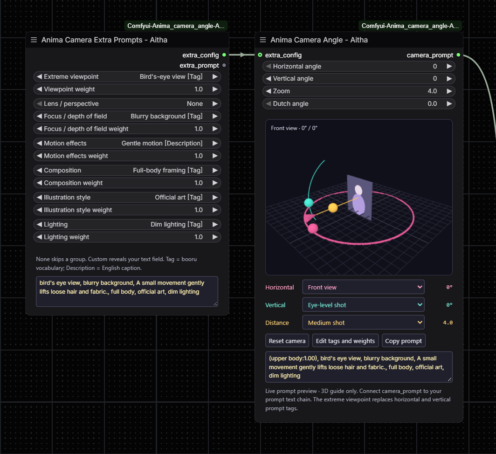

# Comfyui-Anima_camera_angle-Aitha

English camera prompt controls for Anima, with an interactive 3D guide, Qwen-style preset dropdowns, and a larger illustration preset library. Forked from [xunying7860/Comfyui-Anima_camera_angle](https://github.com/xunying7860/Comfyui-Anima_camera_angle), with camera control inspiration from [ComfyUI-qwenmultiangle](https://github.com/jtydhr88/ComfyUI-qwenmultiangle).

## Preview



Screenshot supplied by the maintainer from their ComfyUI session. It shows the connected nodes and live previews; it is not an image-generation benchmark.

## What is included

- English node names, inputs, tooltips, viewport controls, and documentation.
- `horizontal_angle`, `vertical_angle`, and `zoom` controls, matching Qwen's naming and ranges.
- Eight horizontal views, four elevation choices, and six framing choices. Dropdowns, numeric widgets, and 3D handles stay synchronized.
- **107 extra presets**: 15 lens / perspective, 12 focus, 12 motion effects, 22 composition, 24 illustration styles, and 22 lighting choices. Four additional extreme viewpoints are available.
- `None` to skip a group, `Custom` to enter your own text, and independent prompt weights. Inactive custom fields and weights are hidden.
- Live prompt previews, copy controls, editable camera tags and weights, and execution previews for connected inputs.
- Separate Aitha node IDs, so the upstream extension and this fork can be installed together.

This package builds prompt text. The viewport is a spatial guide, not a preview of an Anima-generated image. It does not require the Qwen Multiple Angles LoRA or insert its `<sks>` token.

## Installation

1. Download the ZIP from this repository's **Code → Download ZIP**, or use the release ZIP.
2. Extract the folder into `ComfyUI/custom_nodes/` and name it `Comfyui-Anima_camera_angle-Aitha`. The Python files must be directly inside that folder, not inside a second nested folder.
3. Restart ComfyUI and refresh the browser. Search for **Anima Camera Angle - Aitha** or **Anima Camera Extra Prompts - Aitha**, under **Anima / Camera - Aitha**.

Python 3.10 or newer is required. There are no additional Python packages, npm installation steps, build steps, model downloads, or remote API services required by these nodes. The Three.js runtime is bundled locally. Your generation workflow still needs its own Anima model and text encoder.

### Install with Git

Run this from your ComfyUI installation folder:

```bash
cd custom_nodes
git clone https://github.com/AithaEzio/Comfyui-Anima_camera_angle-Aitha.git
```

Restart ComfyUI, then refresh the browser. To update an existing Git installation:

```bash
cd ComfyUI/custom_nodes/Comfyui-Anima_camera_angle-Aitha
git pull --ff-only
```

### Troubleshooting

- **Nodes missing:** check that `__init__.py` sits directly inside the extension folder; restart the ComfyUI server and inspect its startup log.
- **Old labels or stray socket:** restart the server, then hard-refresh the browser with Ctrl+F5. Unused internal sockets from older workflows are cleaned up when the graph loads.
- **3D unavailable:** use the numeric controls and dropdowns; enable browser hardware acceleration / WebGL to use the scene.
- **No prompt effect:** connect `camera_prompt` to your text chain before CLIP Text Encode; the viewport itself does not modify conditioning.
- **Conflicting composition:** choose framing and extra composition presets that agree. For example, use Full body in the camera node with Full-body framing in Extra Prompts.


After updating, restart ComfyUI and hard-refresh the browser to reload both the node definitions and frontend. Version 1.0.1 also removes unused internal tag-settings sockets from saved workflows, preserving the real `extra_config` connection.

## Quick start

Load [examples/anima_camera_aitha.json](examples/anima_camera_aitha.json) for a controls-only example with no other custom node dependencies.

1. Adjust the camera with a dropdown, numeric widget, or colored 3D handle: pink for horizontal, cyan for vertical, gold for zoom. Scroll over the viewport to change zoom. Use **Reset camera** to return to front / eye level / medium framing.
2. Optionally select presets in **Anima Camera Extra Prompts - Aitha** and connect its **extra_config** output to the camera node's **extra_config** input.
3. Join the camera's **camera_prompt** output with your subject / scene prompt using your preferred STRING concatenation node. Feed that combined text into the `text` input of **CLIP Text Encode**. If necessary, convert the encoder's text widget to an input first.

Do not append **extra_prompt** a second time when **extra_config** is already connected: the camera prompt already includes those extras. The second output is for using the extra presets independently of the camera node.

## Camera controls

| Input | Range / default | Meaning |
| --- | --- | --- |
| `horizontal_angle` | 0–360°, default 0° | 0 front, 90 right, 180 back, 270 left. 360 wraps to front. |
| `vertical_angle` | −30–60°, default 0° | Negative looks up; positive looks down. Zero is eye level. |
| `zoom` | 0–10, default 4 | Higher values select closer framing. |
| `roll` | 0–1, default 0 | Any positive value enables the Dutch-angle tag; this is not a precise rotation angle. |
| `extra_config` | Optional STRING connection | Presets from the Extra Prompts node. |

Horizontal presets: front, front-right quarter, right side, back-right quarter, back, back-left quarter, left side, and front-left quarter.

Vertical presets: low-angle (−30°), eye-level (0°), elevated (30°), and high-angle (60°). Elevated and high-angle use the same `from above` tag with different emphasis.

| Distance preset | Selected zoom | Active zoom interval | Default tag |
| --- | --- | --- | --- |
| Wide shot | 1 | 0 ≤ zoom < 2 | `wide shot` |
| Full body | 2.5 | 2 ≤ zoom < 2.75 | `full body` |
| Cowboy shot | 3 | 2.75 ≤ zoom < 3.5 | `cowboy shot` |
| Medium shot | 4 | 3.5 ≤ zoom < 6 | `upper body` |
| Close-up | 8 | 6 ≤ zoom < 9 | `close-up` |
| Extreme close-up | 10 | 9 ≤ zoom ≤ 10 | `extreme close-up` |

The dropdowns show the nearest horizontal / vertical preset and the active framing category; the readouts show the actual numeric values. Intermediate angles remain available. Connected numeric inputs disable their corresponding dropdowns. Such inputs and arbitrary connected JSON strings show a partial local preview until execution supplies the actual output.

## Extra Prompts

All six groups and the extreme viewpoint default to **None**, so adding the node does not silently change your prompt.

| Choice | Behavior |
| --- | --- |
| `None` | Adds nothing from that group. |
| `Custom` | Reveals an editable text field. Your text and existing prompt weighting are preserved. |
| `[Tag]` preset | Uses documented booru-style vocabulary, lowercase with spaces. |
| `[Description]` preset | Uses a concrete English caption describing a visible effect. |

Each active group has a weight from 0.1 to 10, default 1. At 1, its text is added without an extra wrapper. Other values wrap the group's text in ComfyUI weighting syntax. Literal parentheses in built-in tags, such as `watercolor (medium)`, are escaped automatically. Custom text is left as entered.

Extreme viewpoints have a separate weight from 0.1 to 50, default 1. Choosing one replaces the main node's horizontal and vertical prompt tags to avoid conflicting angles. Framing and optional Dutch angle remain active. The 3D guide still represents the numeric camera controls.

Motion options describe a **still image**; they do not animate the camera. Perspective descriptions suggest a visual look rather than measured focal lengths. Keep composition choices consistent with your framing and subject prompt.

See the [complete preset reference](docs/PRESET_REFERENCE.md) and [research notes with primary sources](docs/PRESET_RESEARCH.md). Anima's authors document tag and natural-language prompting, but do not publish an exhaustive per-tag support list. Individual preset effectiveness is checkpoint- and prompt-dependent; image results have not been verified in ComfyUI for this release.

## Tags and weights

Open **Edit tags and weights** in the camera node to change direction, elevation, framing, and Dutch-angle text; enable / disable each axis; and adjust weights. Settings are saved inside the workflow. **Reset camera** preserves these edits; **Reset all tags and weights** restores their defaults.

The original angle multiplier of **10** is retained for continuity. It is an inherited setting, not a newly measured recommendation for every Anima checkpoint. Tune it with your own generations. Zero extra-weight scale is respected, and settings are isolated between nodes. Eye level now emits a tag at exactly zero degrees.

## Converting upstream workflows

Existing original nodes retain their original IDs. To create a separate Aitha copy of a saved JSON workflow, run:

```bash
python tools/migrate_workflow.py path/to/original.json
```

This creates `original-aitha.json` next to the source. You can supply a different output path as the second argument. Existing output files are protected unless `--force` is supplied; the source file is never overwritten.

The converter supports standard UI workflow JSON, nested subgraph definitions, plain API prompt JSON, and API requests containing a `prompt` object. It preserves node IDs, link IDs, connections, custom tag JSON, custom extra text, and unrelated workflow data. Enabled legacy text fields become `Custom`; disabled text is retained without being emitted.

Conversion preserves the old **viewport position**: `horizontal = (pos_x × 180) mod 360`, `vertical = pos_y × 45 + 15`, and `zoom = pos_z × 4.5 + 5.5`. The old viewport's zero position was 15° above eye level. Corrected elevation semantics and new framing intervals can change the generated prompt, so review the result before generating.

Connected legacy numeric axes, connected legacy extra fields, inline UI extra-config strings, and obsolete separate tag / weight nodes require manual migration. The converter stops with a clear error instead of silently changing their meaning. It does not translate arbitrary user-written prompts or third-party node content.

## Validation and release

Standalone checks, with no ComfyUI installation or GPU execution:

```bash
python -m unittest discover -s tests -p test_camera.py -v
npm test
npm run check
```

The frontend tests use Node's experimental VM module support to load the real extension against small DOM / app stubs. They do not run ComfyUI or WebGL. Read the [validation record](docs/VALIDATION.md) and [manual ComfyUI checklist](docs/MANUAL_COMFYUI_CHECKS.md) before publishing a release.

Build a clean source ZIP with `python tools/package_release.py`. It creates a versioned ZIP and SHA-256 file in `dist/`, without caches or Git metadata. The public repository name is **Comfyui-Anima_camera_angle-Aitha**. Set your own repository URL / registry publisher information when publishing; no registry identity is assumed by this package.

MIT licensed. See [LICENSE](LICENSE) and [third-party notices](THIRD_PARTY_NOTICES.md). Anima model weights have a separate license and are not included.
